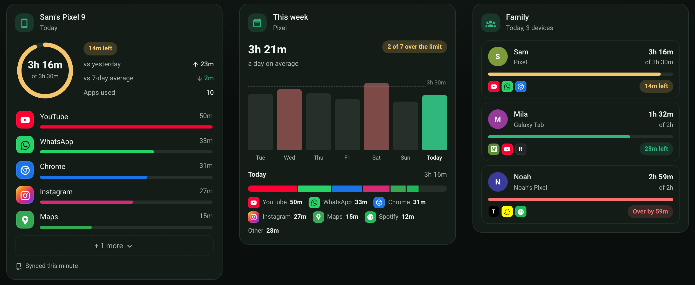
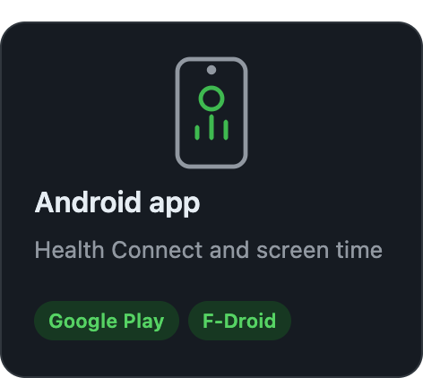
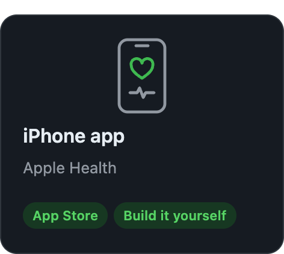
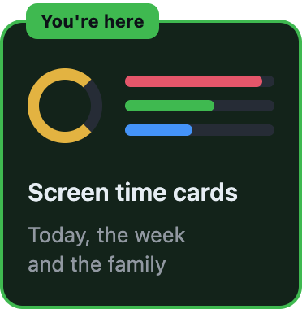
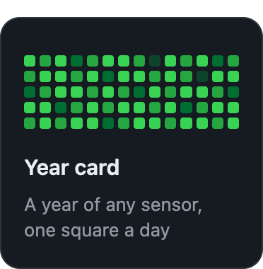
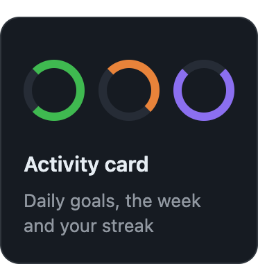
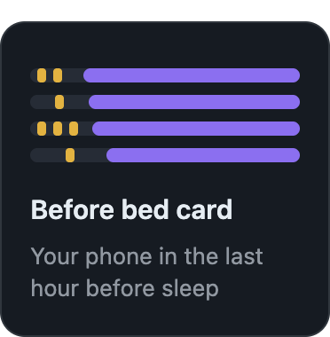

<p align="center">
  
</p>

<h1 align="center">Life Dashboard Screen Time Cards</h1>

<p align="center">
  <b>Screen time on your Home Assistant dashboard: today, the week, and the whole family.</b><br>
  Three cards in one install, each against a daily limit you set, with every app's own icon and minutes.
</p>

<p align="center">
  <a href="https://my.home-assistant.io/redirect/hacs_repository/?owner=owen282000&repository=life-dashboard-screen-time-card&category=plugin"></a>
  <a href="https://github.com/owen282000/life-dashboard-screen-time-card/releases/latest"></a>
  <a href="https://www.home-assistant.io/"></a>
  <a href="https://github.com/owen282000/life-dashboard-screen-time-card/blob/main/LICENSE"></a>
</p>

<p align="center">
  <a href="https://github.com/owen282000/life-dashboard-screen-time-card#install"><b>Install</b></a>
  &nbsp;·&nbsp;
  <a href="https://github.com/owen282000/life-dashboard-screen-time-card#configure">Configure</a>
  &nbsp;·&nbsp;
  <a href="https://github.com/owen282000/life-dashboard-screen-time-card#where-the-screen-time-comes-from">Sources</a>
  &nbsp;·&nbsp;
  <a href="https://owen282000.com/life-dashboard/">Website</a>
</p>

<!-- life-dashboard:nav -->
<p align="center">
  <sub>Life Dashboard: <a href="https://github.com/owen282000/life-dashboard-companion-app">Android app</a> &nbsp;·&nbsp; <a href="https://github.com/owen282000/life-dashboard-companion-app-ios">iPhone app</a> &nbsp;·&nbsp; <a href="https://github.com/owen282000/life-dashboard-ha">Home Assistant integration</a> &nbsp;·&nbsp; <a href="https://github.com/owen282000/life-dashboard-stack">Grafana stack</a> &nbsp;·&nbsp; <a href="https://github.com/owen282000/life-dashboard-sleep-card">Sleep card</a> &nbsp;·&nbsp; <b>Screen time cards</b> &nbsp;·&nbsp; <a href="https://github.com/owen282000/life-dashboard-year-card">Year card</a> &nbsp;·&nbsp; <a href="https://github.com/owen282000/life-dashboard-activity-card">Activity card</a> &nbsp;·&nbsp; <a href="https://github.com/owen282000/life-dashboard-before-bed-card">Before bed card</a></sub>
</p>
<!-- /life-dashboard:nav -->

<p align="center">
  <picture>
    <source media="(max-width: 600px)" srcset="https://raw.githubusercontent.com/owen282000/life-dashboard-screen-time-card/main/docs/readme-hero-phone.png">
    
  </picture>
  <br><sub>Today, the week and the family, each against a daily limit. Sample data from made-up phones.</sub>
</p>

With the Life Dashboard app the cards fill themselves: every app of the day with its own minutes, a sensor per phone for the whole family, and the past week from the first sync on instead of a chart that starts today.

<a href="https://play.google.com/store/apps/details?id=com.owen282000.lifedashboard&referrer=utm_source%3Dgh-screentime-readme%26utm_medium%3Dreadme"></a>

The app reads what Android already counts for Digital Wellbeing and sends it to Home Assistant through the [Life Dashboard integration](https://github.com/owen282000/life-dashboard-ha). The cards also work without the app: with Google Family Link, Microsoft Family Safety, or any sensor that holds today's total. Home Assistant's Companion app has no minutes per app, so a `history_stats` sensor over its interactive sensor gives the total and the week, but not the apps. [Where the screen time comes from](#where-the-screen-time-comes-from) lists every source.

## What you get

- **Today on one phone.** A ring against the daily limit, how much is left or how far over, the difference with yesterday and with the last seven days, and the apps with their minutes. "+ more" shows the rest.
- **The week.** A bar per day with the limit as a line, the days over it marked, and the average. Tap a day to see its apps as one stacked bar.
- **The family.** Everyone in one card, each against their own limit, with their three biggest apps. Tap a person for all their apps. With a `person`, their picture shows.
- **Icons that look like the apps.** A built-in list of 126 popular Android apps with their name, brand color and icon. Any other app gets its first letter on a color of its own. Rename an app, give it your own color, or hide it, per card.
- **Your locale and theme.** English, Arabic, Chinese, Dutch, French, German, Hindi, Italian, Japanese, Portuguese and Spanish, durations in your language, and the colors of your theme in light and dark. The colors for on track, nearly there and over are CSS variables.

## Install

### What you need

- **Home Assistant 2026.3 or newer.**
- **A screen time sensor.** The easiest is an Android phone (Android 8.0 or newer) with the [Life Dashboard app](https://github.com/owen282000/life-dashboard-companion-app). Google Family Link, Microsoft Family Safety and a sensor of your own work too, see [the sources](#where-the-screen-time-comes-from).
- **Not an iPhone.** iOS has no API that lets an app read screen time, so no iPhone app can send it to Home Assistant.
- **With the Life Dashboard app: the [Life Dashboard integration](https://github.com/owen282000/life-dashboard-ha) 1.2.0 or newer.** That version added the `apps` attribute with every app of the day. Older versions only show the top five and the app sensors you switched on.

### Through the Home Assistant Marketplace

The cards are in the Marketplace's default list. In **Settings > Marketplace** (HACS before Home Assistant 2026.11), search for **Life Dashboard Screen Time Cards** and download them. The button opens them in your Home Assistant straight away:

[](https://my.home-assistant.io/redirect/hacs_repository/?owner=owen282000&repository=life-dashboard-screen-time-card&category=plugin)

If the search finds nothing, your Home Assistant has not refreshed its list yet. Until it does, add the repository yourself: the three dots, **Custom repositories**, and `https://github.com/owen282000/life-dashboard-screen-time-card` as the type **Dashboard**.

On storage mode dashboards the resource is registered for you. If your dashboards are in YAML mode, add it yourself:

```yaml
lovelace:
  resources:
    - url: /hacsfiles/life-dashboard-screen-time-card/life-dashboard-screen-time-card.js
      type: module
```

### By hand

Copy `dist/life-dashboard-screen-time-card.js` into the `www` folder of your Home Assistant configuration and add it as a resource of the type JavaScript module with the URL `/local/life-dashboard-screen-time-card.js`.

### Is it working?

Refresh your browser after the download. Without that, the card picker doesn't show the cards and a card you add says "Custom element doesn't exist: life-dashboard-screen-time-card". You should now see **Screen Time**, **Screen Time Week** and **Family Screen Time** in the card picker.

If the entity list in the editor stays empty, the sensor doesn't exist yet. With the Life Dashboard app, the screen time sensors only appear after the phone has sent screen time at least once. That needs Android's **Usage access** permission for the app, and one **Sync Now** on its **Screen Time** tab.

### No screen time sensor yet?

Set up Life Dashboard first. Plan on 15 to 30 minutes the first time, most of it in Home Assistant.

1. Install the [Life Dashboard integration](https://github.com/owen282000/life-dashboard-ha) from the Marketplace.
2. Add it in Home Assistant, under Settings > Devices & services. It shows a pairing QR code.
3. Install the app and scan the code, with **Screen Time** picked under **Send from**. It is listed on Google Play as Health Data for Home Assistant and costs €4.99 (US$4.99) once. The APK on GitHub and F-Droid is free. If the code isn't ready yet, pick **I will set this up later** and pair afterward.
4. Grant the permissions. For these cards that is usage access, on the app's **Screen Time** tab. Health Connect is only for health data.
5. Tap **Sync Now** on the **Screen Time** tab. The phone shows up as a device with `sensor.your_phone_screen_time_today`.
6. Past days need no extra step: every sync sends the last seven days of screen time again. **Send history** on the **Health** tab is for your health data.

The app's [usage guide](https://github.com/owen282000/life-dashboard-companion-app/blob/main/docs/usage.md#with-the-integration) has every step in detail.

## Configure

All three are in the card picker after one install, with a visual editor. Or in YAML:

```yaml
type: custom:life-dashboard-screen-time-card
entity: sensor.your_phone_screen_time_today
limit: "3:30"
```

```yaml
type: custom:life-dashboard-screen-time-week-card
entity: sensor.your_phone_screen_time_today
limit: "3:30"
```

```yaml
type: custom:life-dashboard-screen-time-family-card
people:
  - entity: sensor.sams_pixel_screen_time_today
    person: person.sam
    limit: "3:30"
  - entity: sensor.milas_tablet_screen_time_today
    name: Mila
    limit: "2:00"
```

| Option | Cards | Description |
| --- | --- | --- |
| `entity` | today, week | The phone's screen time today, such as `sensor.your_phone_screen_time_today` |
| `limit` | all | The daily limit: `"3:30"`, `"2h"`, `"45m"` or minutes. With Family Link or Family Safety the limit set there is used when you leave this out. Without any limit the ring fills against the 7-day average |
| `title` | all | Instead of the phone's name, "This week" or "Family" |
| `apps_shown` | today | Apps before "+ more", 5 by default |
| `days` | week | Days in the chart, 3 to 14, 7 by default |
| `people` | family | Per phone: `entity`, and optionally `name`, `person` (for the picture and the name) and its own `limit` |
| `apps` | all | Per package name: `name`, `color`, `icon` (such as `mdi:gamepad-variant`) or `hidden: true` |

```yaml
apps:
  com.whatsapp:
    name: Chats
  com.roblox.client:
    icon: mdi:gamepad-variant
    color: "#e2231a"
  com.google.android.apps.nexuslauncher:
    hidden: true
```

## Where the screen time comes from

- **The Life Dashboard app** (Android): the app reads the usage statistics Digital Wellbeing shows, with the usage access permission, and the integration makes a device per phone. The cards find the phone's other sensors on their own: yesterday, the app sensors, the last sync, and the week from the integration's long-term statistics. With integration 1.2.0 or newer every app of the day comes along; before that, the top five and the app sensors you switched on (on the phone's device page, under disabled entities). The apps of earlier days need those app sensors.
- **Google Family Link**, through [HAFamilyLink](https://github.com/noiwid/HAFamilyLink): pick a child's **Daily Screen Time** sensor. Its apps come along, the week comes from the sensor's statistics, and the daily limit set in Family Link is used unless you give the card your own.
- **Microsoft Family Safety**, through [HAFamilySafety](https://github.com/noiwid/HAFamilySafety): pick the child's **Screen Time** sensor. The apps come from the account's **Applications** sensor and the limit from its time remaining sensor.
- **Any other sensor** with today's total in hours or minutes that starts at zero each day, such as `history_stats` with `type: time` over `binary_sensor.your_phone_interactive`. The week then comes from that sensor's own statistics. An `apps` attribute, as a list of `package`, `name` and `minutes`, gives the apps too.
- **An iPhone** can't be a source: iOS has no API that lets an app read screen time.

## Colors

| Variable | Default |
| --- | --- |
| `--life-dashboard-screen-time-ok` | the theme's `--success-color` |
| `--life-dashboard-screen-time-warn` | the theme's `--warning-color`, from 80% of the limit |
| `--life-dashboard-screen-time-over` | the theme's `--error-color` |

## Part of Life Dashboard

These cards sit on top of Life Dashboard's other parts, and you only install the ones you need. More at [owen282000.com/life-dashboard](https://owen282000.com/life-dashboard/).

<p align="center">
  <b>Start here: the app on your phone</b><br>
  <a href="https://github.com/owen282000/life-dashboard-companion-app"><picture><source media="(prefers-color-scheme: light)" srcset="https://raw.githubusercontent.com/owen282000/life-dashboard-screen-time-card/main/docs/family/android-light.png"></picture></a>
  <a href="https://github.com/owen282000/life-dashboard-companion-app-ios"><picture><source media="(prefers-color-scheme: light)" srcset="https://raw.githubusercontent.com/owen282000/life-dashboard-screen-time-card/main/docs/family/ios-light.png"></picture></a>
</p>

<p align="center">
  <picture><source media="(prefers-color-scheme: light)" srcset="https://raw.githubusercontent.com/owen282000/life-dashboard-screen-time-card/main/docs/family/arrow-light.png"></picture><br>
  <sub>sends your data to</sub>
</p>

<p align="center">
  <b>Where the data goes</b><br>
  <a href="https://github.com/owen282000/life-dashboard-stack"><picture><source media="(prefers-color-scheme: light)" srcset="https://raw.githubusercontent.com/owen282000/life-dashboard-screen-time-card/main/docs/family/stack-light.png"></picture></a>
  <a href="https://github.com/owen282000/life-dashboard-ha"><picture><source media="(prefers-color-scheme: light)" srcset="https://raw.githubusercontent.com/owen282000/life-dashboard-screen-time-card/main/docs/family/ha-light.png"></picture></a>
  <a href="https://owen282000.com/life-dashboard/health-connect-webhook/"><picture><source media="(prefers-color-scheme: light)" srcset="https://raw.githubusercontent.com/owen282000/life-dashboard-screen-time-card/main/docs/family/own-server-light.png"></picture></a>
</p>

<p align="center">
  <picture><source media="(prefers-color-scheme: light)" srcset="https://raw.githubusercontent.com/owen282000/life-dashboard-screen-time-card/main/docs/family/arrow-light.png"></picture>
</p>

<p align="center">
  <b>Cards for your Home Assistant dashboard</b><br>
  <sub>They need Home Assistant; most work with any sensor, and the integration fills them with your history.</sub><br>
  <a href="https://github.com/owen282000/life-dashboard-sleep-card"><picture><source media="(prefers-color-scheme: light)" srcset="https://raw.githubusercontent.com/owen282000/life-dashboard-screen-time-card/main/docs/family/sleep-card-light.png"></picture></a>
  <picture><source media="(prefers-color-scheme: light)" srcset="https://raw.githubusercontent.com/owen282000/life-dashboard-screen-time-card/main/docs/family/screen-time-card-here-light.png"></picture>
  <a href="https://github.com/owen282000/life-dashboard-year-card"><picture><source media="(prefers-color-scheme: light)" srcset="https://raw.githubusercontent.com/owen282000/life-dashboard-screen-time-card/main/docs/family/year-card-light.png"></picture></a>
  <a href="https://github.com/owen282000/life-dashboard-activity-card"><picture><source media="(prefers-color-scheme: light)" srcset="https://raw.githubusercontent.com/owen282000/life-dashboard-screen-time-card/main/docs/family/activity-card-light.png"></picture></a>
  <a href="https://github.com/owen282000/life-dashboard-before-bed-card"><picture><source media="(prefers-color-scheme: light)" srcset="https://raw.githubusercontent.com/owen282000/life-dashboard-screen-time-card/main/docs/family/before-bed-card-light.png"></picture></a>
</p>

## Privacy

The cards only read what Home Assistant already gives your browser: the sensors' state and, for the week, the recorder's statistics. They make no requests of their own, have no telemetry or analytics, and there's no server of mine in the path. The app icons come from Home Assistant's own icon set.

<!-- life-dashboard:built -->
## How this is built

Life Dashboard is a one-person project, and [Claude Code](https://claude.com/claude-code) writes a large part of the code. I decide what gets built, read every change before it is merged, and test it on my own phones and Home Assistant before a release. Automated checks run on every pull request, and the [AI policy](https://github.com/owen282000/life-dashboard-companion-app/blob/main/AI_POLICY.md) explains what the AI does and what I check.
<!-- /life-dashboard:built -->

## Documentation

- [Changelog](https://github.com/owen282000/life-dashboard-screen-time-card/blob/main/CHANGELOG.md)
- [Screen time sensors](https://github.com/owen282000/life-dashboard-ha/blob/main/docs/entities.md#screen-time) of the integration: every entity, the `apps` attribute and the sensors per app
- [The Health dashboard](https://github.com/owen282000/life-dashboard-ha/blob/main/docs/dashboard.md#screen-time-cards) of the integration, with a screen time view to put these cards on
- [Usage access on the phone](https://github.com/owen282000/life-dashboard-companion-app/blob/main/docs/usage.md#usage-access-for-screen-time), and why the numbers can differ from [Digital Wellbeing](https://github.com/owen282000/life-dashboard-companion-app/blob/main/docs/usage.md#screen-time-does-not-match-digital-wellbeing)

## Help and contributing

Bugs go to [issues](https://github.com/owen282000/life-dashboard-screen-time-card/issues) here. Questions go to the integration's [Discussions](https://github.com/owen282000/life-dashboard-ha/discussions). No GitHub account? Use the [feedback board](https://owen282000.com/life-dashboard/feedback/), which needs no account. Everything on it is public, so leave out app lists, logs and webhook URLs.

Pull requests are welcome, see [CONTRIBUTING](https://github.com/owen282000/life-dashboard-screen-time-card/blob/main/CONTRIBUTING.md). The three cards are one JavaScript file with no dependencies and no build step. Security problems go through a [private advisory](https://github.com/owen282000/life-dashboard-screen-time-card/security/advisories/new).

## Support the project

Stars, shares and good bug reports all help. If you want to chip in for the evenings that go into it, there's [Ko-fi](https://ko-fi.com/owen282000). The cards stay free and open source (MIT) either way.

MIT licensed. See [LICENSE](https://github.com/owen282000/life-dashboard-screen-time-card/blob/main/LICENSE).

<!-- life-dashboard:footer -->
<p align="center">
  <sub>Made by <a href="https://github.com/owen282000">Owen Vogelaar</a> for the self-hosting and quantified self crowd.</sub><br>
  <sub>Google Play and the Google Play logo are trademarks of Google LLC.</sub><br>
  <sub>Apple, the Apple logo and App Store are trademarks of Apple Inc.</sub>
</p>
<!-- /life-dashboard:footer -->
